<p align="center">
  
</p>

<p align="center">
  <b>I teach machines to see, and I bully 120B models into running on hardware that never agreed to this.</b>
</p>

<p align="center">
  <a href="https://023b.pages.dev"></a>
  <a href="https://www.linkedin.com/in/arun-prakash-s-739881230"></a>
  <a href="https://github.com/023b/sophon"></a>
</p>

## Current quest

MSc Computer Vision, Robotics & ML at the University of Surrey, on a Luminary Award. Available for part-time work and internships, and I bring my own GPU problems.

## Hall of fame (and of things that should not have worked)

| | |
|---|---|
| **[Sophon](https://github.com/023b/sophon)** | A team of AI agents you can watch argue, each in its own terminal. Its phantom mode runs a 120B model on a CPU-only mini PC. Dead slow. Still counts. |
| **Factory vision QC** | 3 cameras, 6 TensorRT engines and a Jetson Orin Nano inspecting wiper motors at 17 to 20 ms per crop. A production line does not accept "works on my machine". |
| **[STELLA-80](https://github.com/023b/stella80)** | A self-hosted study vault. Local models turn lecture slides into searchable notes, so at least something reads them. |
| **[BCI](https://github.com/023b/BCI)** | Simulates a brain-computer interface from a webcam. It reads your face, not your mind. For now. |
| **The homelab** | One tiny ThinkCentre doing the job of a small cloud: media, photos, LLM chat, home automation and a WhatsApp assistant called Wes. |

## Equipment

```text
see      PyTorch · OpenCV · YOLOv8 · FastFlow · TensorRT · Jetson
think    Ollama · llama.cpp · LangChain · ChromaDB · Hugging Face
survive  Linux · Docker · FastAPI · Tailscale · systemd · Bash
```

## Past lives

QbytX · Rubixe · DataMites · IBM (via Prolearn) · Pantech Solutions

<p align="center"><sub>Slow is still running.</sub></p>
